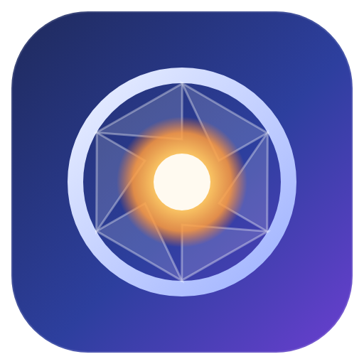

# Lumen Studio

A photo editor for Windows that combines a **Lightroom-style** library and non-destructive Develop module
with **Photoshop-style** layers, masks, selections and painting tools.



## Install on Windows

1. Download **`Lumen-Studio-Setup-1.0.0.exe`**. Get it from this repository's
   [Releases](../../releases) page, or from the latest successful run of the
   **Build Windows installer** workflow under [Actions](../../actions) (artifact *Lumen-Studio-Windows-Installer*).
2. Double-click the installer. The app isn't code-signed, so Windows SmartScreen may say
   *"Windows protected your PC"*. Click **More info → Run anyway**.
3. Pick an install folder and finish. You get a Start-menu entry and a desktop shortcut.
   Windows 10 or 11 (64-bit) is required.

To uninstall: *Settings → Apps → Lumen Studio → Uninstall*. Your library and presets are kept in
`%APPDATA%\Lumen Studio`.

## What it can do

The app has three modules, switched at the top right (or with `Ctrl+Alt+1/2/3`).

### Library (like Lightroom's Library)
- Import single photos or whole folders, or drag & drop them onto the window.
- Thumbnail grid with star ratings (`0`–`5`), pick/reject flags (`P` / `X` / `U`), search, sorting and filters.
- Metadata panel (camera, lens, ISO, shutter, aperture, date).
- Quick Develop: apply presets, Auto Tone, and copy/paste/sync settings across many photos.
- Batch export of selected photos to JPEG, PNG, WebP or TIFF, with resizing.

### Develop (like Lightroom's Develop)
All adjustments are **non-destructive**: they're stored with the photo and rendered on the GPU in real time.
- **Basic**: white balance (temperature, tint, picker, auto), exposure, contrast, highlights, shadows,
  whites, blacks, clarity, dehaze, vibrance, saturation, Auto Tone.
- **Tone Curve**: RGB plus separate red, green and blue curves.
- **Color Mixer**: hue, saturation and luminance for 8 color ranges, plus a B&W mix.
- **Color Grading**: shadow, midtone and highlight color wheels with balance.
- **Detail**: sharpening, plus luminance and color noise reduction.
- **Effects**: vignette and film grain.
- 15 built-in presets with live hover preview, and your own saved presets.
- Crop & straighten, spot healing, before/after view (`\`), history and a filmstrip.

### Edit (like Photoshop)
- **Layers**: pixel and text layers, 16 blend modes, opacity, visibility, reordering (drag & drop),
  duplicate, merge down, flatten, layer masks (paint on them, gradient on them, invert, apply).
  Every pixel layer can also have its own Develop adjustments.
- **Selections**: rectangle, ellipse, lasso and magic wand, with add/subtract/intersect modes, feather,
  expand/contract, invert, and crop to selection.
- **Tools**: move, crop & straighten, free transform (`Ctrl+T`), brush (with pen-pressure support), eraser,
  clone stamp, spot-healing brush, gradient, paint bucket, text, eyedropper, hand and zoom.
- **Filters**: Gaussian blur, motion blur, soft glow, unsharp mask, add noise, pixelate, oil paint, emboss,
  find edges, posterize, threshold and vignette, all with live preview.
- **Adjustments**: brightness/contrast, levels, hue/saturation, invert, desaturate, sepia.
- **Image**: image size, canvas size, rotate, flip, trim.
- Undo/redo (50 steps) with a history panel, plus clipboard copy/paste with other apps.
- **Projects** (`.lumen` files) keep every layer, mask and adjustment, so you can continue later.

### File formats
- **Open**: JPEG, PNG, WebP, AVIF, GIF, BMP, TIFF, camera RAW and HEIC.
  - Camera RAW (CR2, CR3, NEF, ARW, RAF, ORF, RW2, DNG and more) opens the full-size preview JPEG
    that the camera embeds in the file. It doesn't do a true RAW conversion.
  - HEIC/HEIF (iPhone photos) uses Windows' own codecs. If one won't open, install
    *HEIF Image Extensions* and *HEVC Video Extensions* from the Microsoft Store.
- **Export**: JPEG, PNG, WebP, TIFF.

## Keyboard shortcuts (most used)

| Action | Keys | Action | Keys |
|---|---|---|---|
| Undo / Redo | `Ctrl+Z` / `Ctrl+Y` | Brush size | `[` / `]` |
| Open / Import | `Ctrl+O` / `Ctrl+Shift+O` | Free transform | `Ctrl+T` |
| Save project | `Ctrl+S` | New layer | `Ctrl+Shift+N` |
| Export | `Ctrl+Shift+E` | Duplicate / layer via copy | `Ctrl+J` |
| Fit / 100% | `Ctrl+0` / `Ctrl+1` | Select all / deselect | `Ctrl+A` / `Ctrl+D` |
| Before / after | `\` | Auto tone | `Ctrl+U` |
| Toggle panels | `Tab` | Copy / paste develop settings | `Ctrl+Shift+C` / `V` |

Tool keys in Edit: `V` move, `M` marquee, `L` lasso, `W` wand, `C` crop, `B` brush, `E` eraser,
`S` clone, `J` heal, `G` gradient/bucket, `T` text, `I` eyedropper, `H` hand, `Z` zoom.
Hold `Space` to pan with any tool. *Help → Keyboard Shortcuts* lists everything.

## For developers

Requirements: Node.js 20+.

```bash
npm install
npm start            # bundle the UI and launch the app
npm test             # unit tests
npm run dist:win     # build the Windows installer into dist/
```

`dist:win` runs natively on Windows. On Linux it also needs Wine (`wine64` + `wine32`).
The GitHub Actions workflow builds and smoke-tests the installer on a real Windows runner for every push,
and publishes a GitHub Release when a `v*` tag is pushed.

UI tests (headless Chromium + Electron via Playwright):

```bash
npm run build:renderer
node test/ui/scenario.mjs             # end-to-end feature walk-through
node test/ui/pixels.mjs               # rendering accuracy checks
xvfb-run -a node test/ui/electron-smoke.mjs   # real Electron app (Linux needs a display)
```

### Project layout

| Path | What's there |
|---|---|
| `electron/` | Main process (window, dialogs, file access, Windows codec bridge) and the preload bridge |
| `src/js/develop.js` | GPU develop pipeline (WebGL2 shaders), presets, auto tone, white balance |
| `src/js/document.js`, `render.js` | Layers, masks, undo history and compositing |
| `src/js/tools/` | Canvas tools |
| `src/js/ui/` | Panels, menus, dialogs, library grid |
| `src/js/imageio.js` | Decoding (TIFF, RAW previews, HEIC) and EXIF |

## License

MIT
